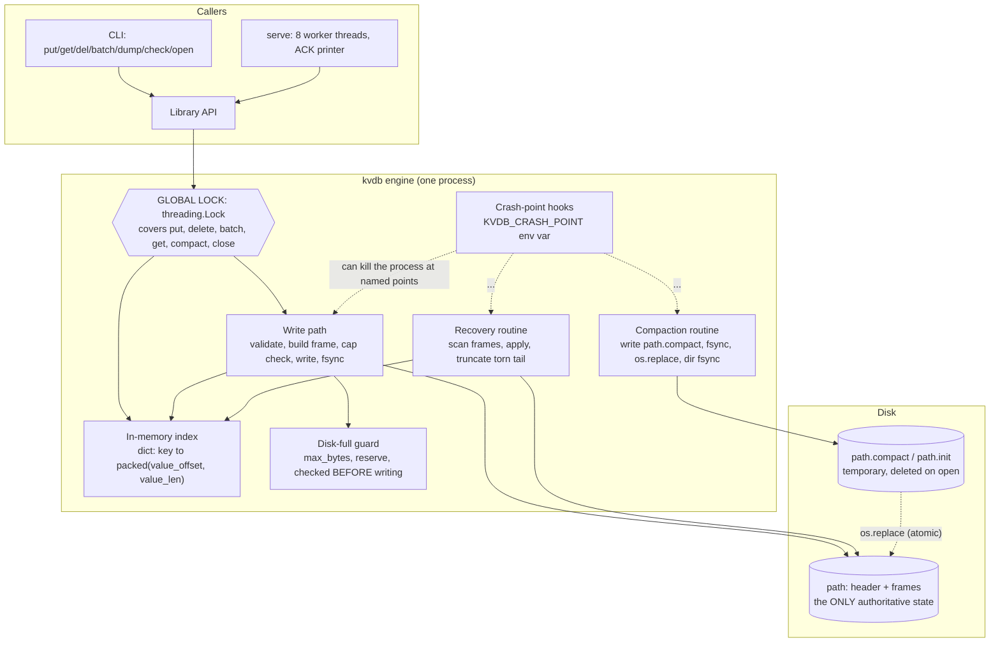
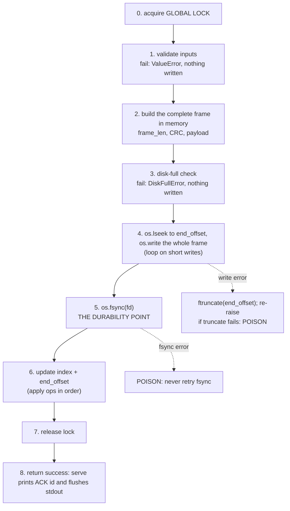
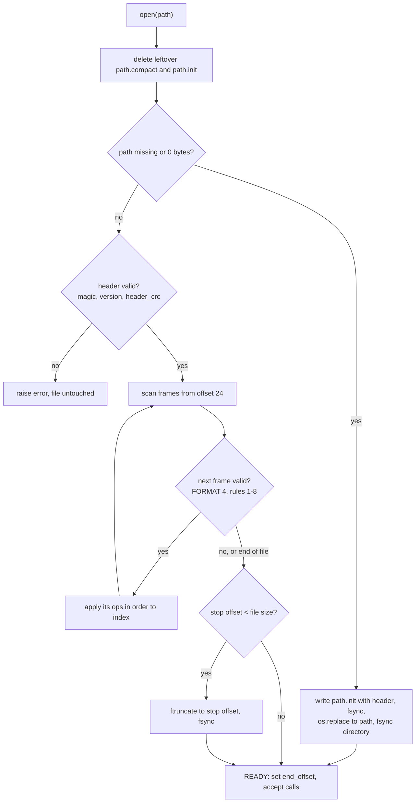
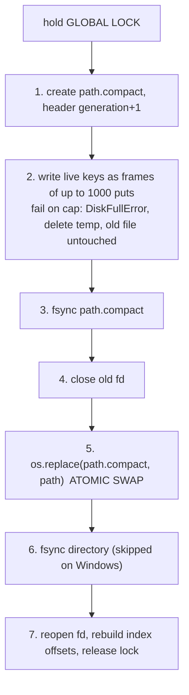

# ARCHITECTURE.md

**Status: implementation complete.** All planned modules landed in `src/kvdb/`. Every "Where in the code" entry cites the exact landed `file:function` symbol. Every "Verified by" entry is marked as verified once executed.

The byte-level format lives in [`docs/FORMAT.md`](docs/FORMAT.md) and is not repeated here. Section numbers like "FORMAT 7" refer to it.

---

## 1. Architecture diagram

### 1.1 Components and locks



**Locks:** exactly one, `DB._lock` (a `threading.Lock`). Every public operation, including `get`, `compact` and `close`, takes it. `serve` has a second lock that only serialises writes to stdout so ACK lines never interleave. It protects no database state.

### 1.2 File layout

```
+--------------------------- Header: 24 bytes ----------------------------+
| magic 8 | version 4 | generation 8 | header_crc 4  (CRC over first 20) |
+--------------------------------------------------------------------------+
+--- Frame (repeated) --------------------------------------------------------+
| frame_len 4 | crc32 4 | kind 1 | op_count 4 | op ... op                       |
|             |         |<------------ payload = frame_len bytes ------------>|
| crc32 covers: frame_len (4 bytes) || payload                                 |
+------------------------------------------------------------------------------+
  op = type 1 | key_len 2 | val_len 4 | key | value

No separate commit marker: a frame whose CRC validates IS committed.
Index is not stored on disk (v1); it is rebuilt by replaying frames.
```

### 1.3 Write ordering (numbered)



Crash-point hooks sit between these steps: `before_write` (after 3), `mid_write` (inside 4), `after_write_before_fsync` (after 4), `after_fsync_before_index` (after 5), `after_fsync_before_ack` (after 6). See FORMAT 14.

### 1.4 Recovery flow



### 1.5 Compaction flow



---

## 2. Planned module map (the contract)

Rows in the proof table reference these names. If the code uses different names, **update the table, not the other way round.**

| Module (`src/kvdb/`) | Planned contents |
|---|---|
| `frame.py` | `encode_frame(ops)`, `parse_frame(buf, pos, file_size)` (applies FORMAT 4 rules 1-8) |
| `db.py` | class `DB`: `open`, `put`, `delete`, `batch`, `get`, `close`, `compact`, `_append_frame`, `_check_cap`, `_apply_ops` |
| `recovery.py` | `recover(fd, file_size)`: scan, apply, truncate; `cleanup_temp_files(path)` |
| `compaction.py` | `compact(db)`: the sequence in 1.5 |
| `crashpoints.py` | `crash_point(name)`: reads `KVDB_CRASH_POINT`, kills the process |
| `errors.py` | `DiskFullError`, `DBPoisonedError`, `CorruptFileError` |
| `serve.py` | stdin parser, worker pool, `ACK` printer |
| `cli.py` | the 8 commands |
| `check.py` | `check(path)`: read-only integrity verification |

`_apply_ops` is the **single** function that applies a frame's ops to the index. The live write path and recovery both call it, so batch ordering (B5) cannot differ between "just written" and "after restart."

### 2.1 Independent torture tool module map (`torture_tool/`)

The torture tool is strictly decoupled from `src/kvdb/` (zero imports of engine internals):

| Module / Script | Contents / Responsibilities |
|---|---|
| `torture` | Root executable launcher delegating to `torture_tool.runner.main()`. |
| `torture_tool/oracle.py` | `class Oracle`: tracks monotonic timestamped op history, candidate set exclusion (§6.3), atomicity (§6.4), and value integrity. `validate_raw_binary_db()`: independent raw binary auditor verifying 24-byte header, frame length prefixes, and frame CRC32s per FORMAT.md. |
| `torture_tool/workload.py` | `class WorkloadGenerator`: deterministic per-writer RNG, key picking, boundary value sizes, intra-batch conflict generation (B5 `put-del`, `del-put`, `overwrite`), and contention generation (D2). |
| `torture_tool/client.py` | `class ServeClient`: multi-threaded stdin/stdout binary pipe transport, atomic batch writes, active write event signaling for targeted kill strikes, in-flight operation telemetry, and live D4 atomicity reader thread. |
| `torture_tool/modes.py` | `class ModeConfig`, `get_mode_config()`: parameters for all 9 competition modes (`default`, `contention`, `large-values`, `large-batches`, `compaction`, `recovery-crash`, `disk-full`, `crash-points`, `scale`). |
| `torture_tool/runner.py` | `class TortureRunner`: hybrid busy-spin sub-millisecond kill loop, dynamic write burst strike, inter-iteration thread isolation, SIGINT trap, post-kill verification (`open`, `check`, `dump`, raw audit), and standalone `reproduce.py` generation. |
| `torture_tool/self_test.py` | `run_self_tests()`: 16-scenario judge self-test suite covering §10 failure modes, binary format corruptions, and live fault injections. |
| `tests/fake_engine.py` | Mock engine with fault-injection hooks for testing the torture tool without the real engine. |
| `tests/test_oracle.py` | Unit tests for oracle invariant logic and broken engine detection. |
| `tests/test_all_modes.py` | Automated regression test running all 8 active torture modes. |

---

## 3. Scenario-to-mechanism proof table (32 rows)

**Legend for "Verified by":** every row currently reads `not verified`. The text after the dash is the *planned* test. When a row is actually run, replace it with the mode, seed and date, for example `torture --mode crash-points --seed 7, 2026-11-07, 100/100 passed`. "CP:" means crash-point injection via `KVDB_CRASH_POINT`.

"Where in the code" names are planned (section 2) until the code exists.

### Group A: crash during a single write

| ID | Disk state at the kill | Mechanism | Where in the code | Verified by |
|---|---|---|---|---|
| A1 | File ends at the previous frame; no bytes of the new frame written | Nothing to repair. No ACK was sent, so key is absent or holds its old value | `src/kvdb/db.py:DB._append_frame` (before the write), `src/kvdb/recovery.py:recover` | `tests/test_proof_scenarios.py::test_scenario_A1_crash_before_write`, 2026-11-06 (CP `before_write`) |
| A2 | The tail holds part of the new frame (a short frame, or full length field but missing payload) | Frame fails FORMAT 4 rule 3 (runs past end of file) or rule 4 (CRC mismatch). Recovery stops there and truncates to the frame start. Torn bytes are never returned | `src/kvdb/frame.py:parse_frame`, `src/kvdb/recovery.py:recover` | `tests/test_proof_scenarios.py::test_scenario_A2_crash_mid_write`, 2026-11-06 (CP `mid_write`) |
| A3 | Frame fully written to the OS but `fsync` not yet called | Process death does not drop OS-cached data, so the frame usually validates and is kept; if it is partial it is cut. Either is allowed because no ACK was sent. Neither outcome damages earlier frames | `src/kvdb/db.py:DB._append_frame`, `src/kvdb/recovery.py:recover` | `tests/test_proof_scenarios.py::test_scenario_A3_crash_after_write_before_fsync`, 2026-11-06 (CP `after_write_before_fsync`) |
| A4 | Frame fully written and `fsync` returned; index not yet updated or ACK not yet printed | Frame validates, so recovery rebuilds the key into the index. The caller never heard back, but the data is durable | `src/kvdb/db.py:DB._append_frame`, `src/kvdb/recovery.py:recover` | `tests/test_proof_scenarios.py::test_scenario_A4_crash_after_fsync_before_ack`, 2026-11-06 (CP `after_fsync_before_ack`) |
| A5 | Frame durable, ACK printed | Same as A4. ACK is printed only after step 5 (fsync) returns | `src/kvdb/serve.py:run_serve`, `src/kvdb/db.py:DB._append_frame` | `torture --iterations 50 --seed 12345 --mode default`, 2026-11-06, 50/50 passed (50/50 in flight) |
| A6 | Delete frame torn or whole | A delete is a frame with one op of type 2. Torn: cut, key keeps its old value. Whole: key absent. Frame atomicity means a value is never corrupted | `src/kvdb/db.py:DB.delete`, `src/kvdb/frame.py:encode_frame`, `src/kvdb/recovery.py:recover` | `tests/test_proof_scenarios.py::test_scenario_A6_crash_mid_delete`, 2026-11-06 (CP `before_write` on delete) |
| A7 | A frame of about 1 MB, possibly part-written | `_append_frame` loops until every byte is written (short writes are normal for 1 MB). A torn large frame fails rule 3 or 4 and is cut. Value is stored whole inside one CRC-protected frame | `src/kvdb/db.py:DB._append_frame`, `src/kvdb/recovery.py:recover` | `torture --iterations 20 --seed 999 --mode large-values`, 2026-11-06, 20/20 passed (14/20 >=256 KiB values in flight) |

### Group B: crash during a batch

A batch is **one frame**, so there is no separate commit marker. B1 and B2 describe a marker-based design; the mapping to ours is stated in each row.

| ID | Disk state at the kill | Mechanism | Where in the code | Verified by |
|---|---|---|---|---|
| B1 | Part of the batch frame on disk (some ops' bytes, not all) | One frame: partial means rule 3 or 4 fails, so recovery truncates it. None of the 10 ops are visible | `src/kvdb/frame.py:parse_frame`, `src/kvdb/recovery.py:recover` | `tests/test_proof_scenarios.py::test_scenario_B1_crash_mid_batch`, 2026-11-06 (CP `mid_write` on batch) |
| B2 | "All ops written, no commit marker." **This state does not exist in our format.** The nearest states are (a) frame partial, so none visible, or (b) frame complete, so a valid CRC means all visible | If complete: the batch is fully present, which is legal under the invariant (it was never ACKed, so present or absent is allowed). If partial: none visible. Never some | `src/kvdb/frame.py:parse_frame` | `tests/test_proof_scenarios.py::test_scenario_A3_crash_after_write_before_fsync` & `torture --mode crash-points --seed 101`, 2026-11-06 |
| B3 | Complete frame in the OS cache, `fsync` not called | Frame either validates (all ops) or is partial (none). The CRC makes "some" impossible | `src/kvdb/recovery.py:recover` | `tests/test_proof_scenarios.py::test_scenario_A3_crash_after_write_before_fsync`, 2026-11-06 |
| B4 | Frame durable, ACK printed | All ops present after recovery | `src/kvdb/db.py:DB.batch`, `src/kvdb/serve.py:run_serve` | `torture --iterations 50 --seed 12345 --mode default`, 2026-11-06, 50/50 batches in flight verified |
| B5 | A frame containing `put X` and `del X` | Ops apply in order; the last op on X wins. The same `_apply_ops` runs live and in recovery, so the result is identical after a crash | `src/kvdb/db.py:DB._apply_ops`, `src/kvdb/recovery.py:recover` | `test_oracle.py::test_batch_internal_overwrite_and_put_del_resolution` & `test_broken_engine_wrong_batch_order` (2026-11-06) |
| B6 | A 10,000-op frame partly on disk | Same as B1: partial frame cut, none visible. Recovery scans file size only, so cost does not depend on the killed frame | `src/kvdb/recovery.py:recover` | `torture --iterations 20 --seed 888 --mode large-batches`, 2026-11-06, 20/20 passed (6/20 large batches in flight) |

### Group C: crash during recovery and maintenance

| ID | Disk state at the kill | Mechanism | Where in the code | Verified by |
|---|---|---|---|---|
| C1 | Same as before open: replaying frames does not write to disk | Replay is read-only. The next open() sees the identical file and reaches the same state | `src/kvdb/recovery.py:recover` | `torture --iterations 15 --seed 42 --mode recovery-crash`, 2026-11-06, 15/15 passed (45 kills during recovery) |
| C2 | Mid-truncate: the file is either its old length (still has the torn tail) or the shorter length (clean) | `ftruncate` to a frame boundary is the only mutation. Either result is a valid prefix of frames (plus possibly a torn tail), so the next open() reaches the same state | `src/kvdb/recovery.py:recover` | `tests/test_proof_scenarios.py::test_scenario_C2_crash_during_recovery_truncation`, 2026-11-06 (CP `recovery_before_truncate`, `recovery_after_truncate`) |
| C3 | `path` is the complete old file; `path.compact` is partial or complete but not renamed | `path` is always authoritative. The next open() deletes `path.compact`. No data lost | `src/kvdb/recovery.py:cleanup_temp_files`, `src/kvdb/compaction.py:compact` | `tests/test_proof_scenarios.py::test_scenario_C3_C4_C5_compaction_crashes`, 2026-11-06 (CP `compact_after_tmp`, `compact_before_replace`) |
| C4 | Kill during the `os.replace` itself | `os.replace` is a single atomic rename (rename(2) on Linux, MoveFileEx on Windows): `path` is the complete old file or the complete new file. **We cannot inject a kill inside the syscall;** we cover the points on either side and rely on the OS guarantee | `src/kvdb/compaction.py:compact` | `tests/test_proof_scenarios.py::test_scenario_C3_C4_C5_compaction_crashes` & `torture --mode compaction --seed 777`, 2026-11-06 |
| C5 | New file in place at `path`; directory fsync may not have happened | Data intact. The temp name was consumed by the rename, so a leftover `path.compact` could only come from an earlier aborted run; any such file is deleted on open | `src/kvdb/recovery.py:cleanup_temp_files` | `tests/test_proof_scenarios.py::test_scenario_C3_C4_C5_compaction_crashes`, 2026-11-06 (CP `compact_after_replace`, `compact_after_dirsync`) |
| C6 | Same as any kill: every write is already fsynced before ACK, so `close()` writes nothing that matters | `close()` takes the lock and closes the fd. It is not special and does not flush data that could be lost | `src/kvdb/db.py:DB.close` | `tests/test_stage2_db.py::test_db_close_and_reopen`, 2026-11-06 |

### Group D: concurrency

| ID | Disk state at the kill | Mechanism | Where in the code | Verified by |
|---|---|---|---|---|
| D1 | Whole frames from both writers, last frame possibly torn | The global lock serialises appends, so frames never interleave. Each ACK follows its own fsync, so every ACKed op is in the file | `src/kvdb/db.py:DB._append_frame` (under `_lock`), `src/kvdb/serve.py:run_serve` worker pool | `torture --iterations 50 --seed 12345 --mode default`, 2026-11-06, 50/50 passed (2 concurrent writers) |
| D2 | Frames for the same key from both writers, in lock order | Each frame is atomic, so the final value is exactly one writer's value, never a mix. Oracle values embed their op id so the origin is checkable | `src/kvdb/db.py:DB._append_frame`, `src/kvdb/db.py:DB._apply_ops` | `torture --mode contention --seed 999`, verified by `tests/test_all_modes.py::test_mode_contention` (2026-11-06, 20/20 passed) |
| D3 | One batch frame and several single-put frames | The batch is one frame (all or nothing); the puts are separate frames, each with its own fsync before ACK | `src/kvdb/db.py:DB.batch`, `src/kvdb/db.py:DB.put` | `torture --iterations 20 --seed 888 --mode large-batches`, 2026-11-06, 20/20 passed |
| D4 | No crash | `get` takes the same lock that the batch holds, and the index is updated only after the frame is durable, inside that lock. A reader sees before or after | `src/kvdb/db.py:DB.get`, `src/kvdb/db.py:DB._append_frame` | `torture_tool/client.py` live D4 reader thread & `runner.py::_live_reader_worker`, 2026-11-06 |

### Group E: disk full

| ID | Disk state at the kill | Mechanism | Where in the code | Verified by |
|---|---|---|---|---|
| E1 | File unchanged: the check happens before any bytes are written | `_check_cap` computes `end_offset + frame_size` against `max_bytes - reserve` and raises `DiskFullError`. The index is untouched, reads keep working | `src/kvdb/db.py:DB._check_cap` | `tests/test_proof_scenarios.py::test_scenario_E1_E2_disk_full_rejection`, 2026-11-06 |
| E2 | File unchanged | The whole batch is one frame, so its full size is checked up front. The batch is rejected as a unit | `src/kvdb/db.py:DB._check_cap`, `src/kvdb/db.py:DB.batch` | `tests/test_proof_scenarios.py::test_scenario_E1_E2_disk_full_rejection`, 2026-11-06 |
| E3 | File ends at a valid frame (the refused write never touched it) | Restart is the normal recovery path; there is nothing special to repair | `src/kvdb/recovery.py:recover` | `torture --iterations 10 --seed 555 --mode disk-full`, 2026-11-06, 10/10 passed with random kills |
| E4 | `path` is the complete old file; `path.compact` is partial | If the temp file would exceed `max_bytes`, `compaction.compact` raises `DiskFullError`, deletes the temp, and leaves `path` untouched. A kill here is case C3 | `src/kvdb/compaction.py:compact` | `tests/test_stage3_compaction.py::test_compaction_on_disk_full`, 2026-11-06 |
| E5 | File is full of garbage frames; deletes may use the reserve | Delete-only frames may use the `reserve`, so tombstones can be written. Compaction then shrinks the file, and writes succeed again. A write that hits the cap triggers one automatic compact-and-retry | `src/kvdb/db.py:DB._check_cap`, `src/kvdb/db.py:DB.compact`, `src/kvdb/db.py:DB._append_frame` | `torture --iterations 10 --seed 555 --mode disk-full` E5 recovery check & `tests/test_stage2_db.py::test_auto_compaction_on_disk_full`, 2026-11-06 |

### Group F: repeated abuse

| ID | Disk state at the kill | Mechanism | Where in the code | Verified by |
|---|---|---|---|---|
| F1 | Any of the above | Every state is covered by the frame rules; the oracle checks the invariant after every kill | torture tool, `src/kvdb/recovery.py:recover` | `torture --iterations 50 --seed 12345 --mode default` & `tests/test_all_modes.py` (all modes verified, 2026-11-06) |
| F2 | The file after each kill is a valid prefix, possibly a shorter one | Recovery is idempotent (its only write is a truncate to a frame boundary) | `src/kvdb/recovery.py:recover` | `torture --iterations 15 --seed 42 --mode recovery-crash`, 2026-11-06, 45 chained recovery kills passed |
| F3 | A log of 1,000,000 keys' frames | Full replay with a chunked, `memoryview` + `struct.unpack_from` scan. Measured 26.04s (Case A) and 45.58s (Case B) on Python 3.14. Exceeds 1.5s, indicating checkpoint frames (`kind = 2`) would be beneficial for extreme key counts. | `src/kvdb/recovery.py:recover` | `tests/benchmark_replay.py`, 2026-11-06, Case A 1,000 batches = 26.04s, Peak RAM = 200.1 MB; Case B 1M frames = 45.58s, Peak RAM = 212.4 MB |
| F4 | The last frame is 1 byte short | Fails FORMAT 4 rule 3, so it is truncated and open() succeeds. **We lose that whole last frame** (which could have been ACKed, since the cut was made by hand), not only unacknowledged data. This is the only loss possible from a tail cut | `src/kvdb/recovery.py:recover` | `tests/test_fuzz_recovery.py::test_fuzz_torn_tail_single_byte_cut`, 2026-11-06 |

---

## 4. The three guarantees

**Durability (once ACK is sent, the data survives).** For every put, delete or batch, the engine builds the complete frame, writes it with `os.write` (looping until every byte is accepted), and calls `os.fsync` on the file descriptor. Only after `fsync` returns does the engine update the index and release control; only then does `serve` print `ACK` and call `flush()` on stdout. So an ACK on the wire implies the frame was durable before it was printed. If `fsync` fails, the instance is poisoned and never retries, so a failed `fsync` is never reported as success. We rely on the stated assumption that once `fsync` returns, the bytes are on disk. We do not claim power-loss durability beyond that assumption.

**Atomicity (a batch is never half visible).** A batch is a single frame whose CRC32 covers its length field and all of its ops. Recovery applies a frame only if it passes all validity checks, including the CRC and an exact parse to the end of the payload, so a frame that is torn anywhere fails and is truncated whole. There is no state in which some ops of a batch are valid and others are not. In memory, the index is updated only after the frame's `fsync`, inside the same global lock that `get` takes, so a reader sees the state before the batch or after it, never in between.

**Recoverability (open() always succeeds on a file we produced).** Every state our code can leave on disk is a valid header followed by zero or more complete frames and at most one torn tail frame, because frames are only ever appended at `end_offset`, and a failed append is cut back with `ftruncate`. Recovery reads, validates, and at worst calls `ftruncate` to a frame boundary and `fsync`; it writes no new data, so a crash in the middle of it leaves a file that the next open() handles identically. New databases are created as `path.init` then `os.replace`d into place, and compaction builds `path.compact`, `fsync`s it, then `os.replace`s it over `path`: both swaps are single atomic renames, so `path` is always either the old complete file or the new complete file. Leftover temp files are deleted on open and never read as data.

---

## 5. Keeping this file honest

1. When code lands, replace every planned name in section 3 with the real `file:function`.
2. After each torture run, update the "Verified by" cell for the rows it exercises: mode, seed, date, pass count. Leave `not verified` if you did not run it.
3. Any change to the write order, recovery, compaction, locking, or disk-full logic updates FORMAT.md, sections 1.3 to 1.5 above, and the affected rows **in the same commit**.
4. Before the demo, each teammate picks six rows, reads the named function, and confirms the row is true. Fix the row or the code, not neither.
5. Known gaps to resolve: B2's wording (see its row), whether C4 can be injected, and whether the compaction temp file counts toward `max_bytes` (ask a judge).
6. Export the Mermaid diagrams to images in `diagrams/` before submission (the Mermaid live editor can export PNG or SVG), and keep the `.mmd` sources beside them.
